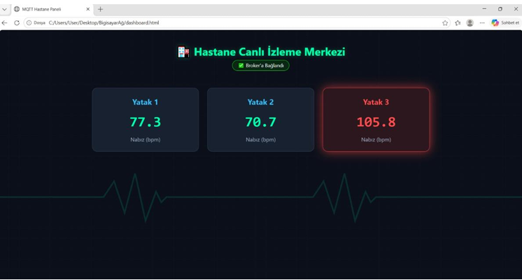

# Secure MQTT-Based Real-Time Patient Monitoring System

A real-time medical telemetry simulation and monitoring system built on the **MQTT (Publish/Subscribe)** protocol. The system simulates patient heart rate (BPM) data, transmits it over an encrypted **TLS (MQTTS)** channel, and visualizes live anomalies on a web-based dashboard via **WebSockets**.

## Key Features
* **Publish/Subscribe Architecture:** Powered by **Eclipse Mosquitto Broker** using a scalable hierarchical topic structure (`hospital/bed[ID]/heartrate`).
* **End-to-End Encryption (MQTTS):** Secured on port `8883` using **TLSv1.2** and custom **OpenSSL** certificates (`CA`, `Server CRT/Key`), verified via **Wireshark** packet analysis.
* **Real-Time Web Dashboard:** Uses a WebSocket bridge (port `9001`) and `mqtt.min.js` to display live BPM readings with zero page reloads.
* **Automated Anomaly Detection:** Triggers visual and terminal crisis alerts when simulated heart rates exceed the critical threshold (`> 100 BPM`).

## Tech Stack
* **Backend:** Python 3.11 (`paho-mqtt`, `json`, `math`)
* **Broker & Security:** Eclipse Mosquitto (v2.0+), OpenSSL (TLS 1.2), Wireshark
* **Frontend:** HTML5, CSS3, JavaScript (`mqtt.min.js`)

## Dashboard Preview


## Setup & Installation
1. **Install Dependencies:**
   ```bash
   pip install paho-mqtt
   Generate TLS Certificates:
Create a certs/ directory in the root folder and generate your local CA and Server certificates using OpenSSL (excluded from repository for security).

Configure Mosquitto:
Enable port 8883 (TLS) and port 9001 (WebSockets) in your mosquitto.conf file and start the broker service.

Run the System:

Start the subscriber: python subscriber.py

Start the publisher simulation: python publisher.py

Open dashboard.html in a modern web browser.

Developer
Sevgi Bağrıyanık
